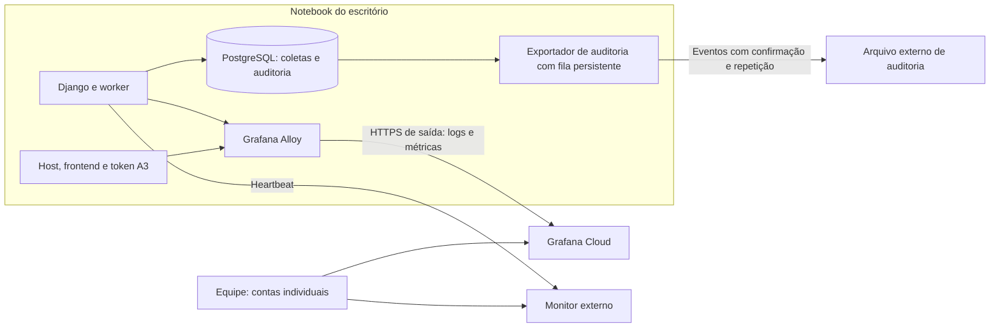

# Sondagem: observabilidade remota e auditoria do RYV Expedientes

Data: 13/10/2026. Escopo: inspeção do código e pesquisa das ferramentas; nenhum serviço foi instalado ou exposto e nenhuma coleta foi disparada. Não houve verificação do estado dos serviços em execução. As estimativas abaixo são de planejamento.

## Recomendação

Adotar **Grafana Cloud + Grafana Alloy no notebook do escritório**, com métricas de disponibilidade e logs de coleta enviados por conexões de saída. Implementar **auditoria explícita no Django**, com cópia externa dos eventos. Acrescentar um monitor externo de ausência de heartbeat para detectar quando o escritório deixa de enviar dados.

Assim, a empresa acessa o painel pelo navegador com contas individuais e continua consultando os registros já recebidos se o notebook, a energia ou a internet do escritório cair. O token A3 e a automação permanecem no escritório. Não é necessário publicar a API ou o banco na internet para enviar telemetria.

O Alloy coleta e encaminha os dados; o Grafana exibe painéis; Loki armazena e consulta logs; o serviço de métricas recebe as séries temporais. Essa integração está descrita na [documentação oficial de coleta com Alloy](https://grafana.com/docs/grafana-cloud/send-data/logs/collect-logs-with-alloy/).

## O que o projeto já oferece

| Evidência no código | Aproveitamento e lacuna |
| --- | --- |
| `docker-compose.yml`: PostgreSQL, backend, worker e frontend opcional | Banco possui healthcheck; os demais não têm healthcheck declarado. O README também prevê frontend Node no host, que precisa entrar no monitoramento. |
| `automation/models.py`: `AutomationRun` | Guarda fonte, ciclo, origem do acionamento, solicitante, horários, resultado, contagens e erro. É uma boa base para o painel de coletas. |
| `automation/services/pje/runner.py`: sequência de fontes | Propaga `requested_by` e `cycle_id` às próximas fontes do ciclo. Permite correlacionar a solicitação manual com o processamento automático. |
| `automation/views.py`: histórico e lista de execuções | Histórico apresenta 30 dias e exclui execuções descartadas; lista de execuções retorna as últimas 20. Os dois retornos não incluem o solicitante. Esses limites de exibição não provam expurgo do banco. |
| `expedientes/models.py`: `ExpedienteEvent` | Vincula alterações de expedientes à coleta e guarda `changes`. Não representa todas as ações dos usuários. |
| `config/settings.py`: `LOGGING` | Logger `automation` envia texto ao console. Não há formato JSON nem contexto uniforme de coleta em todas as mensagens. |
| `entrypoint.sh`: inicialização do assinador | PJeOffice escreve em `/tmp/pjeoffice-startup.log`; coletar somente stdout dos containers não captura continuamente esse arquivo. |
| `automation/urls.py` e worker `processar_coletas.py` | Não há endpoint dedicado de saúde ou heartbeat persistido do worker nesses componentes. Existe consulta autenticada de presença do token. |
| `automation/views.py`: cancelamento, configuração e descarte | Não há registro explícito do autor dessas ações. O descarte elimina comunicações DJEN e parte dos eventos/expedientes, além de marcar execuções como descartadas. |

Os achados consideram os arquivos atuais do workspace, que têm alterações locais anteriores a esta sondagem. Logs antigos não permitem reconstruir com certeza autores de ações que nunca foram registrados.

## Arquitetura proposta

O painel deve marcar **sem dados** quando a telemetria ficar antiga; nunca conservar um sinal verde indefinidamente. Uma queda de heartbeat indica indisponibilidade ou falha no envio, mas não distingue sozinha energia, internet, host e agente. Probes e sinais separados ajudam no diagnóstico.

Para acesso remoto ao aplicativo operacional, caso desejado, usar VPN com permissões por grupo. Isso é uma necessidade separada da consulta ao Grafana Cloud. O Tailscale permite [regras de acesso](https://tailscale.com/docs/features/access-control), e o MFA pode ser aplicado no [provedor de identidade](https://tailscale.com/docs/integrations/identity). A VPN não substitui as permissões dentro da aplicação.

## O que aparecerá no painel

| Visão | Sinais e perguntas respondidas |
| --- | --- |
| Disponibilidade | Frontend responde? API responde? Banco aceita uma consulta? Worker está ativo e fazendo progresso? |
| Máquina | Disco livre, CPU, memória, reinícios e última telemetria recebida. |
| Capacidade de coletar | Leitor/token detectado, socket PC/SC acessível e processo/serviço PJeOffice disponível. São pré-condições; sucesso de autenticação só é confirmado durante uma coleta. |
| Coletas | Última tentativa e último sucesso por fonte, duração, fila, etapa atual, criados/atualizados/resolvidos e erros. |
| Operadores | Quem solicitou, cancelou, descartou ou alterou configurações; quando; qual objeto/ciclo; qual resultado. |

Começar com alertas de API indisponível, ausência de heartbeat, fila envelhecida, coleta sem progresso, falha por fonte, falta de sucesso no horário esperado e disco abaixo do limite. Os limiares devem ser ajustados após medir as durações reais; não há baseline suficiente no código para fixar um SLA.

Separar falha técnica, cancelamento pelo operador, fonte desabilitada e coleta concluída sem resultados. **Zero expedientes não é necessariamente erro.** Uma fonte desligada deve aparecer como tal para não desaparecer silenciosamente do acompanhamento.

O worker atual executa as coletas de forma bloqueante. Um heartbeat apenas no começo do loop pode ficar antigo durante uma coleta legítima. Instrumentar etapas/progresso e um heartbeat independente, com limites de duração; emitir heartbeat de um agente isolado também não comprova que o worker funciona.

## Mudanças necessárias na aplicação

### Saúde e métricas

- Criar `/health/live` para o processo da API e `/health/ready` para dependências essenciais, com timeout curto e sem detalhes sensíveis. A ausência de token deve degradar a capacidade PJe sem declarar o DJEN ou toda a API indisponíveis.
- Persistir heartbeat do worker, etapa atual e último progresso; expor métricas em endpoint privado, acessível apenas ao coletor.
- Medir idade da fila, duração e resultado das coletas, último sucesso por fonte, disponibilidade do token e atraso no envio da auditoria. Nunca tratar ausência de métricas como resultado saudável.
- Incluir o frontend realmente utilizado: container ou processo do host. Fazer probes HTTP locais e, quando houver VPN, um probe externo pelo caminho de acesso da equipe.
- Preservar o processamento com um worker nesta primeira etapa. O código atual recupera globalmente execuções `running` ao iniciar; aumentar réplicas exige rever a propriedade das execuções.

### Logs correlacionados

Emitir JSON em stdout com `timestamp`, `level`, `service`, `event`, `run_id`, `cycle_id`, `source`, `stage`, `duration_ms`, `error_code` e mensagem sanitizada. Usar contexto automático para que os logs do navegador, parser e persistência recebam a mesma identificação da execução.

Registrar início e fim de cada etapa e causas de falha. Capturar os logs do PJeOffice por arquivo ou encaminhamento controlado. Fixar limites de rotação dos logs Docker. No Loki, usar poucas labels estáveis, como serviço/ambiente/fonte; manter IDs de execução, usuário e requisição no JSON ou metadados, evitando [alta cardinalidade](https://grafana.com/docs/loki/latest/get-started/labels/bp-labels/).

O Alloy oferece [coleta de logs Docker](https://grafana.com/docs/alloy/latest/reference/components/loki/loki.source.docker/). Avaliar coleta por arquivos ou proxy de API restrito: montar o socket Docker como `:ro` não torna as operações da API somente leitura. Não conceder esse acesso ao painel dos gestores.

Configurar armazenamento persistente e verificar a WAL de envio de [logs](https://grafana.com/docs/alloy/latest/reference/components/loki/loki.write/) e de [métricas](https://grafana.com/docs/alloy/latest/reference/components/prometheus/prometheus.remote_write/). Testar interrupção de rede, limites de buffer, rotação e rejeição de dados antigos; há limites para recuperação e não se deve prometer entrega ilimitada.

### Auditoria dos operadores

Criar `AuditEvent`, separado de `ExpedienteEvent`, com ID único, horário UTC, ator, nome/identificador preservado, ação, objeto, `run_id`/`cycle_id`, resultado, motivo e alterações permitidas de antes/depois. Mostrar horários em `America/Fortaleza`.

Cobrir solicitação/reexecução, cancelamento, descarte do dia, ativação/desativação de fontes, mudança do horário efetivo de coleta, login/logout, alteração de senha sem registrar o conteúdo e exportação de relatórios. Ações automáticas devem identificar o ator como sistema. Registrar também recusas relevantes, diferenciando tentativa de ação concluída.

No sucesso de ações que alteram dados, gravar o evento e a alteração na mesma transação. Um exportador lê uma fila persistente, envia e confirma a cópia externa com deduplicação por ID. Falha externa não deve apagar eventos nem bloquear o loop das coletas; atraso de exportação precisa gerar alerta.

O evento de descarte deve sobreviver ao descarte e guardar o autor, os ciclos afetados e as contagens. Não usar FK com exclusão em cascata para fazer a auditoria desaparecer junto do objeto. Impedir edição/exclusão pela interface e restringir a conta do operador. Contas individuais são indispensáveis: uma conta compartilhada identifica a conta, não a pessoa.

Rever o agendamento ao introduzir novos perfis: hoje `enqueue_due_runs()` lê o horário do primeiro `UserProfile`. Transformar o horário operacional em configuração global explícita e auditável evita que o usuário altere um horário que não é o aplicado pelo agendador.

Para preservação contra alteração por administradores locais, manter cópia externa com credencial de escrita restrita, gestão de retenção separada e, conforme a exigência da empresa, armazenamento com retenção imutável. Apenas esconder o botão de apagar ou encadear hashes no mesmo host não garante integridade contra quem administra a máquina.

## Acesso e dados

Criar perfis de consulta para gestores, operação e administração. Conferir se o plano escolhido permite separar o acesso aos dados de auditoria; ocultar um painel não restringe necessariamente consultas ao conjunto de logs. Se necessário, separar destinos/instâncias.

Enviar por padrão metadados técnicos, contagens e identificadores internos. Não enviar PIN, segredo TOTP, senhas, cookies, tokens de sessão, corpos completos de requisições nem HTML/screenshots do PJe ao agregador. Evidências de falha podem conter dados processuais e devem ficar em repositório restrito, com prazo próprio. Definir os campos permitidos na origem antes de enviar logs já existentes.

Para acesso operacional remoto, ajustar servidor de produção, HTTPS, cookies e origens autorizadas. Hoje o Dockerfile usa `runserver`, o Compose publica a API em todas as interfaces e habilita CORS amplo. Esses pontos precisam de revisão antes de ampliar o acesso à aplicação. Envio de telemetria por saída não depende de abrir essas portas no roteador.

## Alternativas e custos

| Opção | Adequação | Custo e operação |
| --- | --- | --- |
| Grafana Cloud + Alloy + auditoria própria | Preferida para reduzir manutenção e consultar logs fora do escritório | Serviço gerenciado; exige controlar volume, retenção e permissões. |
| Grafana + Loki + Prometheus em VPS externa, com Alloy local e VPN | Boa se a empresa quiser administrar armazenamento e retenção | VPS, backups, disco, atualização e tempo de administração. Dimensionar com amostra real. |
| Uptime Kuma externo + auditoria própria | Boa primeira entrega para disponibilidade; sozinho não atende à pesquisa completa de logs | Hospedagem externa e administração; pode ser complementado com Loki depois. |
| Toda a observabilidade no notebook | Útil para diagnóstico local | Painel fica inacessível junto da máquina/escritório; insuficiente como único ponto de consulta. |

O [Uptime Kuma](https://github.com/louislam/uptime-kuma) oferece monitores HTTP, TCP e push, entre outros. Outra opção para detectar ausência de execução é o [Healthchecks.io](https://healthchecks.io/docs/configuring_checks/), que trabalha com agenda, sinais de início/sucesso e tolerância de atraso. Esses serviços complementam a pesquisa de logs e não registram por si as ações dos operadores.

Na consulta de 13/10/2026, o [Grafana Cloud](https://grafana.com/pricing/) anuncia plano gratuito com 50 GB de logs/mês e retenção de 14 dias; Pro a partir de US$ 19/mês mais uso, com 30 dias para logs. O gratuito serve para piloto, mas não constitui arquivo duradouro de auditoria. Na mesma data, o [Tailscale Standard](https://tailscale.com/pricing) anuncia US$ 8 por usuário/mês; só seria necessário nesta proposta se adotarmos acesso por VPN. Valores são referências, não orçamento fechado, e não incluem câmbio, impostos, armazenamento externo ou trabalho de implantação.

Como proposta inicial, usar 30 dias de logs técnicos e 12 meses de eventos de auditoria, sujeitos à política da empresa. Para maior prazo de auditoria, manter arquivo externo consultável sem depender da retenção do Loki. Medir uma semana de volume antes de contratar ou dimensionar a VPS.

## Plano de execução e validação

1. **Disponibilidade remota:** saúde da API/banco, heartbeat/progresso do worker, monitor externo, contas de consulta e alertas. Estimativa: 1–2 dias de trabalho.
2. **Logs e painel de coletas:** JSON correlacionado, coleta Alloy, PJeOffice, métricas por fonte, filtros e buffer persistente. Estimativa: 2–3 dias.
3. **Auditoria:** eventos transacionais, autoria, permissões, exportação externa, consulta e preservação dos descartes. Estimativa: 3–5 dias.
4. **Piloto:** acompanhar uma semana de operação, ajustar alertas e medir volume/recursos. Contratação e configuração de identidades podem ampliar o prazo.

Critérios de aceite em ambiente de teste: parar API e worker separadamente; remover token; simular tribunal indisponível e coleta sem resultados; interromper rede e verificar reenvio; recriar containers; cancelar e descartar com dois usuários distintos; verificar sobrevivência da auditoria; excluir acesso de um gestor; conferir ausência de segredos nas amostras; verificar que o painel externo continua acessível quando o host local está desligado. Testar também como o próprio monitor externo será supervisionado.

Para iniciar a implantação, definir quem terá acesso, provedor de identidade da empresa, canal/destinatários dos alertas, prazo de retenção e preferência por serviço gerenciado ou VPS. A recomendação técnica permanece: painel externo, telemetria enviada por saída e autoria registrada na aplicação.
